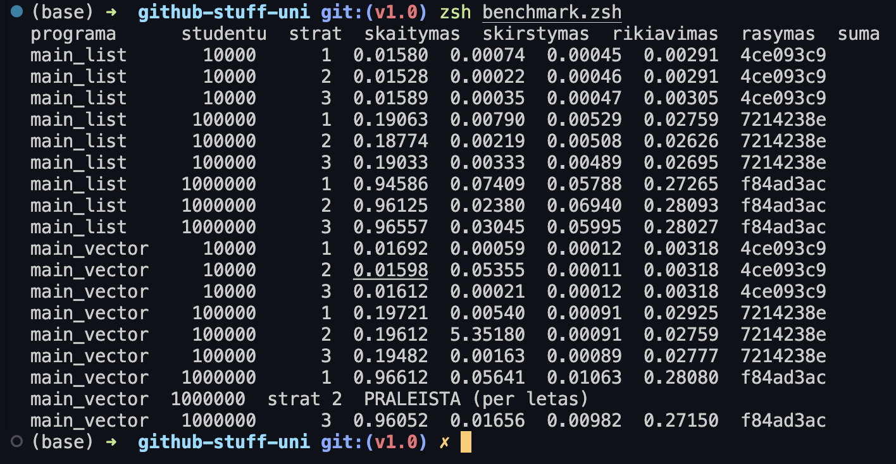
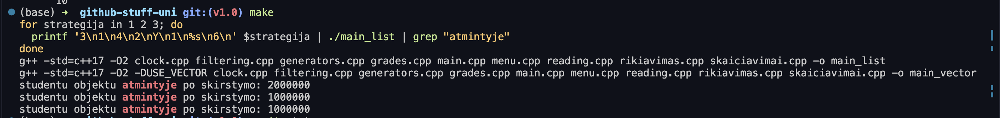

## Testavimas

- Kompiuteris: MacBook (Apple M4 Max, 36 GB RAM), macOS 27.2
- Kompiliatorius: `g++ -std=c++17 -O2`
- Failai: `studentai10000.txt`, `studentai100000.txt`, `studentai1000000.txt` (visuose testuose tie patys)
- Kiekvienas laikas yra **5 paleidimu vidurkis** (sekundemis), gautas skriptu `benchmark.zsh`:

```zsh
zsh benchmark.zsh
```

- Visi neapdoroti rezultatai yra faile `benchmark_laikai.txt`.
- Strategijos 2 ir 3 dirba tiesiogiai su pradiniu konteineriu (kopija nedaroma).
- Visu strategiju ir abieju konteineriu sukurti failai yra identiski (patikrinta kontroline suma paskutiniame lenteles stulpelyje), todel laikai palyginami.



## Rezultatai: skirstymas i dvi grupes (s)

| Studentu | list, strat. 1 | list, strat. 2 | list, strat. 3 | vector, strat. 1 | vector, strat. 2 | vector, strat. 3 |
|---|---|---|---|---|---|---|
| 10 000 | 0.00074 | 0.00022 | 0.00035 | 0.00059 | 0.05355 | **0.00021** |
| 100 000 | 0.00790 | 0.00219 | 0.00333 | 0.00540 | 5.35180 | **0.00163** |
| 1 000 000 | 0.07409 | **0.02380** | 0.03045 | 0.05641 | 535.4 (vienas paleidimas) | **0.01656** |

Kitu zingsniu laikai su 1 000 000 studentu (s):

| Zingsnis | list | vector |
|---|---|---|
| nuskaitymas | 0.95 | 0.96 |
| rikiavimas | 0.06 | 0.01 |
| irasymas i failus | 0.28 | 0.27 |

## Atminties naudojimas

Po skirstymo programa isveda, kiek studentu objektu yra atmintyje (su 1 000 000 studentu):

| Strategija | Studentu objektu atmintyje |
|---|---|
| 1 | 2 000 000 |
| 2 | 1 000 000 |
| 3 | 1 000 000 |



Pirmoje strategijoje kiekvienas studentas egzistuoja du kartus: pradiniame konteineryje ir viename is dvieju naujuju. Strategijos 2 ir 3 studentus perkelia, todel kiekvienas yra tik viena karta. Skaiciuojami objektai, ne baitai, bet visi objektai vienodo tipo, todel atminties sanaudos studentams skiriasi apie 2 kartus.

## Isvados

- **`vector` + strategija 2 netinka dideliems duomenims.** Kiekvienas `erase` priverstina visus uz istrinto studento esancius elementus pasislinkti, todel laikas auga kvadratiskai: 10 kartu daugiau studentu reiske apie 100 kartu daugiau laiko. Su 1 000 000 studentu uztruko apie 9 minutes (matuota viena karta).
- **`vector` + strategija 3 yra greiciausia**: apie 3.4 karto greitesne uz strategija 1 ir daugiau nei 30 000 kartu greitesne uz strategija 2 (1 000 000 studentu). `stable_partition` perrikiuoja vienu praejimu, o `erase` istrina uodega vienu kvietimu, nieko neperstumdamas.
- **`list` atveju laimi strategija 2**, nes trynimas is saraso tik pakeicia rodykles tarp kaimynu. Strategija 1 yra apie 3 kartus letesne. Strategija 3 `list` atveju arti strategijos 2, bet jos nenugali.
- **Strategija 1 naudoja du kartus daugiau atminties** studentams (zr. atminties lentele).
- **Skirstymas nera pagrindine kliutis**: su 1 000 000 studentu nuskaitymas uztrunka apie 0.95 s, o skirstymas 0.02-0.07 s (isskyrus `vector` + strategija 2).
- **Rikiavimas** su `vector` yra apie 6 kartus greitesnis nei su `list` (`list` elementai atmintyje isbarstyti, `vector` - is eiles).
- Vieno paleidimo laikai svyruoja (apie 10-30 %), todel naudojami 5 paleidimu vidurkiai.